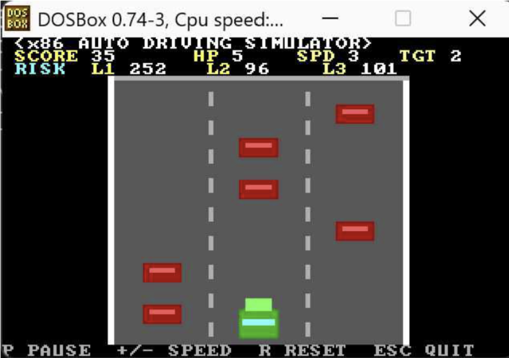
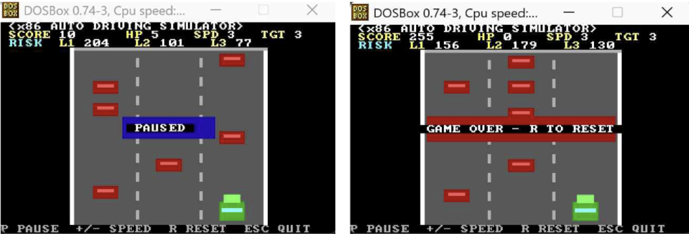

# Lane-Based Autonomous Obstacle Avoidance Simulator using x86 Assembly Language

**Computer Architecture Project | Spring 2026**  
Hankuk University of Foreign Studies

## 1. Project Overview



This project implements a **2D autonomous obstacle avoidance simulator using x86 Assembly Language** in a 16-bit DOS environment.

The simulator features a three-lane road where a vehicle automatically avoids moving obstacles. Unlike conventional racing games, the vehicle calculates the risk level of each lane, selects the safest target lane, and changes lanes autonomously.

The project demonstrates how low-level computer architecture concepts can be applied to an interactive graphics-based simulation.

## 2. Features

- Three-lane road environment with 2D graphics
- **Risk-based autonomous lane selection and obstacle avoidance**
- Random obstacle generation and continuous movement
- Collision detection and HP system
- Score tracking and adjustable speed
- Real-time HUD displaying score, HP, speed, target lane, and lane risks
- Pause, reset, and game-over functionality

## 3. System Workflow

```text
Initialize Game
       ↓
Generate & Move Obstacles
       ↓
Calculate Lane Risks
       ↓
Select Safest Target Lane
       ↓
Autonomous Lane Change
       ↓
Collision Detection
       ↓
Update HUD & Render Screen
       ↓
    Repeat
```

The autonomous driving logic evaluates obstacle positions and assigns higher risk values to obstacles closer to the vehicle. The vehicle then moves one lane at a time toward the lane with the lowest risk.

## 4. Development Environment

| Component | Technology |
|---|---|
| Language | x86 Assembly Language (16-bit) |
| Assembler | EMU8086 |
| Execution | DOSBox 0.74-3 |
| Graphics | VGA Mode 13h (320×200, 256 colors) |
| Architecture | Intel 8086 |

## 5. Controls

| Key | Function |
|---|---|
| `P` | Pause / Resume |
| `R` | Restart |
| `+` / `-` | Increase / Decrease speed |
| `ESC` | Exit |

## 6. Project(Directory, Repository) Structure

```text
Lane-Based-Autonomous-Obstacle-Avoidance-Simulator-x86/
├── src/
│   └── Lane_Auto_Obstacle_Simulator.asm
|
├── docs/
│   ├── screenshots/
│       ├── Basic execution screen.png
│       └── more execution screen.png
│   ├── Lane-Based Autonomous Obstacle Avoidance Simulator.pdf
│   └── demo.mp4
|
└── README.md
```

## 7. How to Run

1. Open `Lane_Auto_Obstacle_Simulator.asm` in EMU8086.
2. Compile the source code and save the executable as `sim.exe`.
3. Launch DOSBox and mount the directory containing `sim.exe`.
4. Execute the program:

```dos
mount c C:\dos
c:
sim
```

## 8. References

- [Car-Racing-Game-x8086](https://github.com/Mahmoud-Khaled-Nasr/Car-Racing-Game-x8086)
- [driving-car-asm](https://github.com/yousseftawakal/driving-car-asm)
- [8086-Assembly-Projects](https://github.com/yousefkotp/8086-Assembly-Projects)
- [NASM Documentation](https://www.nasm.us/docs.php)

## Author

**Lee Shinbi**  
Department of Computer Engineering  
Hankuk University of Foreign Studies
